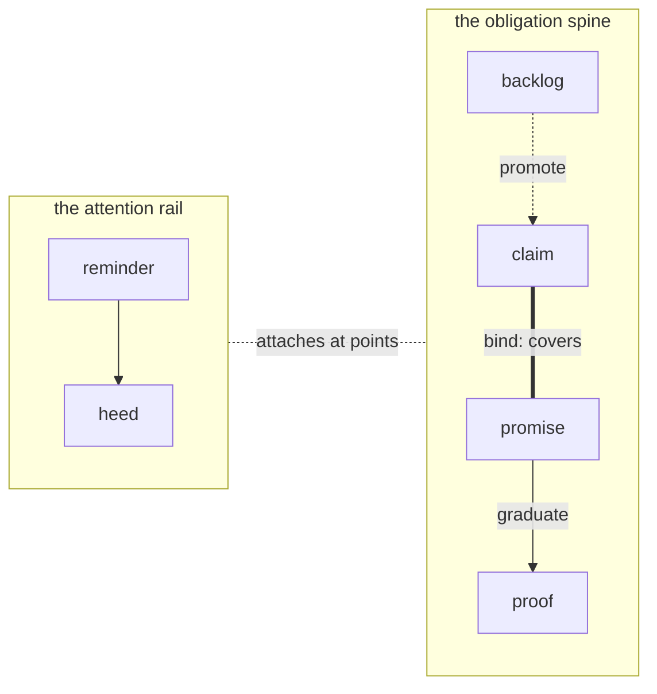

# Evidence & Obligations

A test suite answers one question: *did anything go red?* A project's **ledger** answers a better
one: *is everything we claim actually evidenced?* This section is about the machinery that makes
the second question checkable — how an obligation enters a project, how it gets discharged, and
how to catch the ways a green run can lie.

## The lifecycle — a state machine with optional parts

Prova's lifecycle is a chain of **two-state links**: a claim and its bound promise, a promise
and its proof, a reminder and its heed. Each link is a small state machine on its own; the
interior nodes are hinges that join them into a spine. You can use as little or as much of the
chain as you like — but each link *locks in* as you opt into it, and that is the whole design.

- **claim ⇄ promise — a binding, not a flag.** A [claim](./claims-and-covers.md) is prose that
  became an obligation; a [promise](../writing-tests/promises-and-burndown.md) is a proof
  authored ahead of its implementation. `covers` joins them — two artifacts, one link. Only a
  claim can be bound; "ready to be bound" is exactly what claim-state means.
- **promise ⇄ proof — a flag toggle, in place.** The tense change on one artifact:
  `promises = "reason"` flips to `proves = "reason"` the day the behavior goes real.
- **reminder ⇄ heed — an orthogonal rail, not a fifth car.** The attention account is a
  parallel two-state track for conditional gates that *attaches* to the spine at points; it
  does not come "after" proofs. (Reminders ship with the next prova release and will be
  documented with it.)
- **backlog ⇄ claim — the designed cold tier.** *Status first, so you don't reach for vapor:
  this tier is designed and landing soon; nothing below documents shipped behavior.* A backlog
  item will be the same doc-tier anchor in its unbound cold state — captured without being
  owed, outside the ledger's graph entirely, with exactly one exit: promotion to claim (or
  deletion). Promotion is always legal; demotion is legal only while the claim is unbound, so
  in-flight work can never be accidentally re-frozen.

**Enter anywhere; one local law.** Every precursor is optional: a proof with no prior promise
is fine, a promise with no backing claim is fine, a claim nobody promised yet is fine. Layered
on that is exactly one forward-mandatory link — **a promise compels its proof**. The moment a
promised behavior goes real, the run fails demanding graduation; that single machine-driven
link is the exception, and it is why proofs are trustworthy. Everything to your left is
human-driven: claims stay owed until someone acts, and the ledger reports rather than forces.

**Attestation is the proof's run-facet.** A proof in the tree is a statement; a proof that
*executed and passed in the recorded run* is evidence. The [run record](./record-and-attest.md)
carries that difference, and `prova attest` gates on it — the one stage a suite that never ran
cannot fake. `prova evidence` reports the spine as counts: CLAIMED / BOUND / PROMISED /
ATTESTED.

## What each link buys — rigor as a dial

Each link you lock in buys exactly one named guarantee:

| Locked link | The guarantee |
|---|---|
| a proof | **verified** — the behavior holds, at the boundary a caller sees |
| a promise behind the proof | **can't be silently dropped** — authored intent graduates or fails, never rots |
| a claim behind the proof | **documented** — the stated spec and the verification name each other |
| an unbound claim | **stated and owed** — scoped work the ledger reports until it is bound |
| a heed on the rail | **enforced** — a watched condition becomes a gate |

"Use as much or as little as you want" is therefore not hand-waving: **your rigor is literally
the set of links you've locked in.** And because every node is a valid entry point and every
link is independently addable in either direction, the chain is adoption-order-independent:

- **Legacy enters at the right** — wrap the existing tests as proofs and buy nothing else;
  backfill *leftward* later by adding claims behind the proofs that deserve documentation.
- **Greenfield enters at the left** — state the claims, bind promises, drive to proof, exactly
  the [spec-first workflow](../workflows/spec-first.md).

Both converge on the same fully-linked chain from opposite ends.

## Traceability, both directions

`prova owed` audits the forward direction: a stated obligation with nothing backing it (an
unproven claim, an open promise, a dangling cover). The mirror — a proof with no stated claim
behind it, verification without documentation — is the same graph read from the other end;
that reverse query is designed and arrives with the backlog tier. Both rest on the same hinge:
a proof declares its backing claim **explicitly** (`covers`), which is what makes the queries
exact rather than heuristic.

## The question verbs

Three verbs read the ledger; none of them executes a proof body:

| Verb | Question |
|---|---|
| [`prova evidence`](../reference/cli.md#prova-evidence) | Where does this project stand? The counts: CLAIMED / BOUND / PROMISED / ATTESTED, then what is owed. |
| [`prova owed`](../reference/cli.md#prova-owed) | What still needs doing? Every open obligation from every origin, in one list. |
| [`prova attest`](../reference/cli.md#prova-attest) | Did the proof covering *this* claim actually run and pass? Bare, it gates **every** claim — the CI form. |

`prova owed` is deliberately one list. Open promises, unproven claims, and dangling covers
share it because an agent orienting in a repo asks one question — *what is owed here?* — and an
answer living in two places has one that goes stale. Origin is a column, not a separate
concept.

## In this section

1. **[Claims & Covers](./claims-and-covers.md)** — turning prose into checkable obligations:
   anchors, the `[claims]` table, the `covers` binding, and pinning against silent drift.
2. **[The Run Record & Attestation](./record-and-attest.md)** — what did *not* run: the record
   every run writes, why "0 failed" is not evidence, and the `attest` gate that closes the gap.
3. **[Falsifiers](./falsifiers.md)** — proving a proof can fail: `falsified_by` and the
   `prova tests falsify` pass that catches vacuous green.

The authoring side of the spine's right half lives in
[Promises & Burndown](../writing-tests/promises-and-burndown.md).
