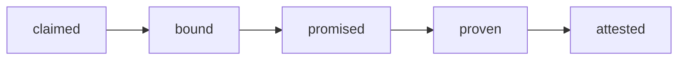

# Evidence & Obligations

A test suite answers one question: *did anything go red?* A project's **ledger** answers a better
one: *is everything we claim actually evidenced?* This section is about the machinery that makes
the second question checkable — how an obligation enters a project, how it gets discharged, and
how to catch the ways a green run can lie.

## The lifecycle

Every obligation travels one road:

- **Claimed** — a sentence in prose became normative: a `<!-- claim: id -->` anchor in a design
  doc, README, or plan marks it as *intended to be proven*.
- **Bound** — some proof declares `covers = "<doc>#<id>"`. The claim has an owner.
- **Promised** — the proof was authored ahead of the implementation, flagged
  [`promises = "<reason>"`](../writing-tests/promises-and-burndown.md): red by design, the
  executable backlog.
- **Proven** — the implementation landed and the flag graduated to `proves = "<reason>"` in the
  same commit. The context survives; the bar holds.
- **Attested** — the covering proof **executed and passed in the recorded run**. Everything
  above this stage can be satisfied by a suite that never ran; attestation is the stage that
  cannot.

Not every obligation needs the whole road — a plain test with no claim behind it is simply a
proof that holds a line. The road exists so that when prose *does* make a promise, nothing
between the sentence and the passing run is taken on faith.

## The question verbs

Three verbs read the ledger; none of them executes a proof body:

| Verb | Question |
|---|---|
| [`prova evidence`](../reference/cli.md#prova-evidence) | Where does this project stand? The counts: CLAIMED / BOUND / PROMISED / ATTESTED, then what is owed. |
| [`prova owed`](../reference/cli.md#prova-owed) | What still needs doing? Every open obligation from every origin, in one list. |
| [`prova attest`](../reference/cli.md#prova-attest) | Did the proof covering *this* claim actually run and pass? Bare, it gates **every** claim — the CI form. |

`prova owed` is deliberately one list. Open promises, unproven claims, dangling covers, and due
reminders share it because an agent orienting in a repo asks one question — *what is owed here?* —
and an answer living in two places has one that goes stale. Origin is a column, not a separate
concept.

## In this section

1. **[Claims & Covers](./claims-and-covers.md)** — turning prose into checkable obligations:
   anchors, the `[claims]` table, the `covers` binding, and pinning against silent drift.
2. **[The Run Record & Attestation](./record-and-attest.md)** — what did *not* run: the record
   every run writes, why "0 failed" is not evidence, and the `attest` gate that closes the gap.
3. **[Falsifiers](./falsifiers.md)** — proving a proof can fail: `falsified_by` and the
   `prova falsify` pass that catches vacuous green.

Two close relatives live elsewhere: [Promises & Burndown](../writing-tests/promises-and-burndown.md)
(the authoring side of the lifecycle — proofs ahead of implementation) and the reminders verb
family (the *attention* account, which watches the future rather than guarding the past — it
ships in the next prova release and will be documented with it).
