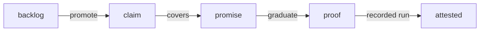

# The Bigger Picture

Prova is one static binary that turns a project's definition of done into proofs that run. It drives
the real system from outside, conducts the language's own test tools, holds quality metrics to
ratchets, and keeps a ledger of what the docs claim against what actually ran. People and agents use
the same commands, and CI runs the same suite.

This page introduces each capability as a unit: what it is for, in a few lines, and where to read
more. Each one is useful on its own, and you can adopt them in any order.

## The problems it solves

| Without it | With Prova |
|---|---|
| "Done" is a claim in a pull request description. | "Done" is a proof that runs, and the run is recorded. |
| Design docs drift from the code, and nobody can tell which sentences are still true. | Normative sentences carry a claim anchor; `prova owed` lists every one no proof covers. |
| TODO comments describe work that was never encoded. | Future behavior is written as a *promise*: a real proof, red by design, that CI tracks. |
| A green suite where everything skipped looks like one that proved everything. | The run record names every skipped and deselected proof; `prova attest` refuses a claim whose proof did not run. |
| Each repository glues its own harness from shell scripts and Makefiles. | One runner, one manifest shape, and the same lanes in every repository. |
| Standards live in a wiki and are enforced by whoever looks. | A shared standards package runs as proofs in every repository. |
| Quality slips one `unwrap()` at a time. | Ratchets refuse any regression against a committed baseline. |
| An agent says it implemented the spec. | The agent is handed the failing proof, the claim it covers, and the intent behind it. |

## Black-box proofs

A proof drives the system at the boundary a caller uses (HTTP, gRPC, GraphQL, a CLI's argv, a stdio
conversation, a terminal, the filesystem) and asserts on what it actually does. Fixtures bring the
system into existence and tear it down, so a proof reproduces from nothing. Tests are plain Lua, with
pytest-grade fixtures and scopes.

Read more: [Writing Tests](../writing-tests/index.md), [Testing Real Systems](../writing-tests/testing-real-systems.md).

## From backlog to proof

Every obligation travels one road, and each stage is a state Prova can check:



1. **Backlog**: captured in the document where it belongs, deliberately not owed yet.
2. **Claim**: promoted in place; owed until a proof covers it.
3. **Promise**: a proof written ahead of the code, flagged with its reason. Red by design; CI stays green.
4. **Proof**: the code lands, the body goes green, and `promises` becomes `proves` in the same commit.
5. **Attested**: the covering proof executed and passed in the recorded run.

```markdown
<!-- claim: busy-not-absent -->
Contention and absence are different answers and must never be conflated.
```

```lua
prova.test("a saturated pool is never reported as unsatisfiable", {
  covers   = "docs/design.md#busy-not-absent",
  promises = "pool reports busy (ticket 1234)",
}, function(t) … end)
```

Every stage is optional, so a legacy suite can start at the right and add claims later, while new
work can start from the prose. `prova evidence` reports where a project stands, and `prova owed`
lists exactly what is still owed.

**How a failing proof guides an agent.** The failure names its file and line and ends with a line
that reruns exactly that proof. `covers` points at the normative sentence it must satisfy, and the
`promises` reason (later `proves`) keeps the intent in the test itself. The rule the agent works
under: never weaken a proof to pass it. What it finds and does not fix is captured as backlog, a
claim, a promise or a reminder, never added to the current change.

Read more: [Evidence & Obligations](../evidence/index.md), [Backlog](../evidence/backlog.md),
[Promises & Burndown](../writing-tests/promises-and-burndown.md).

## The X-Fail rule

Promises follow strict expected-failure (xfail-strict) semantics, per test. The flag and the body's
result decide the verdict together:

| Flag | Body fails | Body passes |
|---|---|---|
| `promises = "…"` | **PROMISED**: open, reported, CI stays green | **FAIL**: promise kept, graduate it to `proves` in this commit |
| `proves = "…"` or none | **FAIL**: a real regression | **PASS**: holds the line from now on |

There is no window where a regression can hide, and no way to land an implementation while the test
still says "not yet". `prova tests --promises` lists the open surface, and `prova tests burndown` is
the implementer's loop.

**Falsifiers** are the inverse check: a test declares `falsified_by`, a mutation its body must catch,
and `prova tests falsify` applies it and inverts the verdict. A body that still passes is *vacuous*.

Read more: [Promises & Burndown](../writing-tests/promises-and-burndown.md), [Falsifiers](../evidence/falsifiers.md).

## Deputed tests and linters

Prova does not replace a language's test framework; it conducts it and adopts the verdict. `prova
run ut` can run `cargo nextest` once and adopt every case; Maven, pytest, Jest and anything else that
writes JUnit XML work the same way, and linters that write SARIF are adopted as findings. A rule of
thumb: if a real caller could observe the bug, it deserves a proof; if only the implementation can,
it deserves a unit test. Prova runs both and reports one verdict.

Read more: [Quality](../quality/index.md), [Deputed Verifiers](../quality/deputed-verifiers.md).

## Ratchets

A ratchet measures a number, compares it to a floor committed in `.prova/baselines/`, and refuses any
regression. Existing debt becomes a standing number instead of a wall of red, and improvements are
banked with `--update-baseline`, which tightens and never loosens.

```json
"rust.coverage.lines":     { "value": 75.5, "direction": "higher_is_better" },
"rust.unwrap.production":  { "value": 2,    "direction": "lower_is_better", "goal": 0 },
"rust.functions.too_long": { "value": 0,    "direction": "lower_is_better" }
```

Coverage, production `unwrap()` and `expect()` counts, function length, file size, duplication, or
any lint with a threshold, such as clippy's cognitive complexity. A `goal` turns a floor into a
burndown: reaching it fails the run until the gain is banked. When a ratchet goes red, it is pointing
at a seam in the code.

Read more: [Ratchets](../quality/ratchets.md).

## Topologies, doubles and drivers

A **topology** is a named factory for a whole environment, defined once. A proof uses it as a
fixture, `prova up` holds it live for development, an agent holds it warm over MCP, and CI provisions
it fresh, so the environment cannot drift between them.

The default stand-in for a dependency is the real thing, ephemeral: `postgres.container(ctx)` gives
the system a real engine for the proof's scope. Mocks (`http.mock`, `grpc.mock`, socket, WebSocket,
terminal and stdio mocks) are for what cannot run locally, for fault injection, and for asserting the
interaction itself from the mock's journal.

Read more: [Topologies](../writing-tests/topologies.md), [Mocking & Proxying](../writing-tests/mocking-and-proxies.md).

## Packages and plugins

Everything is a package: your project, its dependencies, and the topologies they advertise share one
`prova.toml` shape, pinned in the repository so local runs and CI resolve the same versions. Official
packages provide Postgres, MySQL, Redis, MongoDB, Kafka, Pulsar, RabbitMQ, S3 and Vault as ephemeral
containers, `kind` as a real Kubernetes cluster, and Parallels VMs. `prova packages` searches the
registry; `prova init package` scaffolds your own.

Read more: [Packages](../packages/index.md), [Official Packages](../packages/official-packages.md).

## Shared standards across many repositories

An organization's standards become proofs in one package that every repository pins. Each rule has a
stable id, a title and the reason it exists; a deliberate exception is a waiver with a reason,
reported on every run; and raising the bar for the fleet is a release of the package.

Read more: [The Shared Standards Package](../patterns/shared-standards-package.md).

## Lanes: one interface to every project

Profiles in the manifest define **lanes**: named, described run modes that `prova run --list` prints.
When repositories share lane names (`ut`, `quality`, `coverage`, `all`, `ci`), a person or agent
arriving at an unfamiliar one already knows how to work in it, whatever the language. Switches keep
expensive classes out of the inner loop, and `must_run` turns a missing tool into a failure where an
environment is promised. `prova init rust-project` sets up the whole surface for a Rust project.

Read more: [Lanes](../quality/lanes.md), [Manifest & Profiles](../running-prova/manifest-and-profiles.md).

## Where it sits in the delivery cycle

```text
.prova/prova.toml   the manifest: lanes, dependencies, topologies, spec sources
.prova/baselines/   committed ratchet floors
.prova/packages/    the project's own packages
proofs/             the proofs, beside the code
docs/               claims and backlog, in the prose they belong to
```

Write the proof (red is correct), implement until `prova --last-failed` is green, run `prova run all`
before pushing, and commit the proof with the code. CI runs the same binary and the same suite through
`prova-rs/run-action`, with failures annotated on the pull request, followed by `prova attest` as the
gate that every claim is evidenced. The run record names what did not run, and a test that failed and
passed on the same tree is FLAKY, never green.

Read more: [CI & Output](../running-prova/ci-and-output.md), [The Run Record & Attestation](../evidence/record-and-attest.md),
[Locks, Flakes & Reruns](../running-prova/locks-and-scale.md).

## Working as a team

- **One question.** `prova owed` answers "what is owed here?" for anyone arriving, person or agent.
- **Specs go through review.** Claims, promises and their reasons live in the repository; a pinned
  claim reports STALE when its wording changes until someone re-accepts it in a diff.
- **Capture without scope creep.** Findings go to the backlog, dated, and a team promotes a theme
  when it is ready, which stages the next burndown.
- **Reminders** watch the world: an upstream release, a drifted pin, a backlog item past its date.
- **Shared machines.** Locks such as `prova.writes("cargo")` are held across every Prova process, so
  parallel jobs, a second agent and CI on one machine queue instead of colliding.
- **Agents as teammates.** `prova mcp` serves the same commands to agents, with the practice built in.

Read more: [Reminders](../quality/reminders.md), [Workflows](../workflows/index.md).
